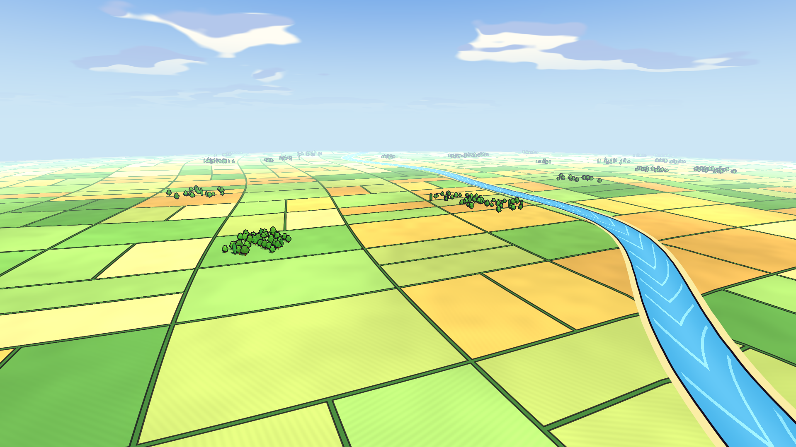

# World

The place you fly over: 4 km x 4 km of cartoon countryside ("Porco Rosso meets Sea of
Thieves"): a patchwork of green and golden fields with hedges, a winding river, a few low
hills, clumps of low-poly trees, under a bright stylized sky.

- **Contract** (`Contract/`): `WorldBounds`, constants other modules may use: the ground
  spans `-HalfSize..HalfSize` (2000 m) on X and Z around the origin at `GroundY` (0 m);
  hills stay below `MaxHillHeight` (15 m). No messages yet.
- **Core** (`Core/`): `WorldModule`, the entry class (`IModule`). It has no rules yet: it
  only counts steps (no allocations), so the shell loads the scene.
- **Godot** (`Godot/`): `Main.tscn` with `WorldView.cs`, which builds the ground mesh
  (200 x 200 grid, hills from a few Gaussian bumps, a shallow dip under the river) and the
  trees (two `MultiMesh`es: round trees and poplars, seeded so the layout never changes) in
  `_Ready`. Few draw calls: ground, round trees and poplars, each a toon pass plus an outline
  pass, and the sky.
  - `Toon.gdshaderinc`: cel lighting (shadow / half-lit / lit bands), included by
    `Ground.gdshader` (fields, hedges, river and banks painted from world position; its
    river curve must match `WorldView.RiverX`) and `Tree.gdshader` (vertex colors).
  - `Outline.gdshader`: ink lines by inverted hull, a fixed pixel width on screen.
  - `Sky.gdshader`: gradient sky, sun halo, two-tone cartoon clouds. The `WorldEnvironment`
    adds depth fog toward the horizon and gentle glow; the warm `Sun` casts soft shadows.
  - `PreviewCamera` frames the scene when it runs alone (screenshots, the editor); it is
    removed when the shell loads the scene, so the player's camera is used.
  - Colors and light energies were tuned on the screenshot renderer (Compatibility/OpenGL).
  Other modules may copy the shaders' approach but must not reference these files.
- **Tests** (`Tests/`): `WorldModuleTests`: starts and ticks without allocating, is the only
  entry class, targets net10.0, no Godot in Core or Contract.

Test it alone: `./test.sh World`. Screenshot:
`./screenshot.sh modules/World/Godot/Main.tscn modules/World/screenshot.png`.
